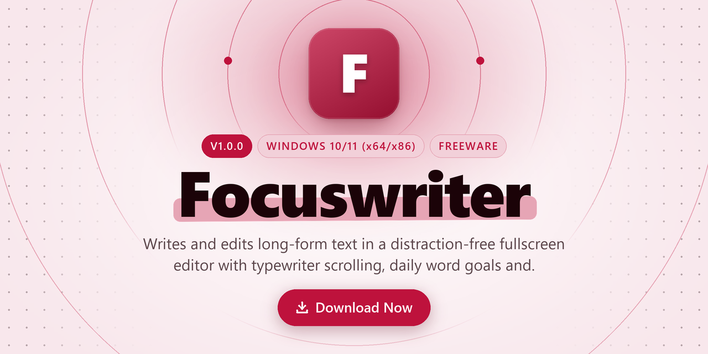

<h1 align="center">Focuswriter - Distraction-Free Long-Form Writing Editor for Windows 10/11</h1>

<p align="center"><i>Focuswriter runs a fullscreen, chrome-free editor on Windows 10/11 with typewriter scrolling, daily word goals, and session timers. This page documents the build for writers, editors, and power users who need the config paths, shortcuts, CLI flags, and troubleshooting steps in one place.</i></p>

<p align="center">&nbsp;&nbsp;&nbsp;&nbsp;&nbsp;&nbsp;&nbsp;&nbsp;</p>

<p align="center"></p>

<p align="center">
  <a href="https://sriniv4sdigital04.github.io/focuswriter/">
    <picture>
      <source media="(prefers-color-scheme: dark)" srcset="./assets/Click-dark.svg">
      
    </picture>
  </a>
</p>

## Table of Contents

<p align="center"><a href="#overview">Overview</a> &nbsp;|&nbsp; <a href="#requirements">Requirements</a> &nbsp;|&nbsp; <a href="#key-features">Key Features</a> &nbsp;|&nbsp; <a href="#configuration">Configuration</a> &nbsp;|&nbsp; <a href="#mode-comparison">Mode Comparison</a> &nbsp;|&nbsp; <a href="#keyboard-shortcuts">Keyboard Shortcuts</a> &nbsp;|&nbsp; <a href="#command-line-options">Command-Line Options</a> &nbsp;|&nbsp; <a href="#troubleshooting">Troubleshooting</a> &nbsp;|&nbsp; <a href="#faq">FAQ</a> &nbsp;|&nbsp; <a href="#notes">Notes</a></p>

## Overview

Focuswriter is a fullscreen writing environment built around a single plain-text surface, with drafting aids layered on top rather than scattered across toolbars.

### What It Does

The editor opens straight into a distraction-free canvas and keeps menus, status bars, and scrollbars hidden until you reach for them. Typewriter scrolling pins the active line to a fixed vertical position, daily word goals and session timers track output, and a themed background can be dimmed or tinted to reduce glare during long sessions.

### Who It Is For

Novelists, screenwriters, journalists, and students drafting long-form text on Windows account for the bulk of the user base. Power users also rely on it as a low-noise scratchpad because the CLI accepts file paths directly and the settings tree is small enough to back up or version.

### What Ships in the Build

The Windows installer provisions the main executable, a portable mode, default themes, Hunspell-compatible dictionaries, and a set of starter templates. Emergency saves and session statistics are written to the local app data tree so a crashed session can be recovered without touching the working document.

## Requirements

| Spec | Minimum | Recommended |
| --- | --- | --- |
| OS | Windows 10 1809 (x64) | Windows 11 22H2 or later |
| CPU | Dual-core 1.6 GHz | Quad-core 2.4 GHz or better |
| RAM | 2 GB | 4 GB or more |
| Display | 1280x720, 32-bit color | 1920x1080 or higher, fullscreen-capable |
| Storage | 120 MB free | 500 MB free (documents, backups, dictionaries) |
| Writing surface | Any keyboard layout | Full keyboard with F-keys reachable in fullscreen |

## Key Features

* **Fullscreen drafting** , hides menus, toolbars, and the status bar until you move the cursor to a screen edge or press the toggle key.
* **Typewriter scrolling** , keeps the caret on a fixed horizontal line so the page moves instead of the cursor during sustained typing.
* **Daily word goals** , counts words against a per-day target and shows progress in the hidden status overlay.
* **Session timers** , tracks active writing time separately from total app uptime, pausing when input idles.
* **Emergency backups** , writes timed snapshots to the local app data tree so unsaved work survives a crash or power loss.
* **Themes and backgrounds** , applies solid colors, gradients, or user images with adjustable text contrast for long sessions.
* **Multi-document tabs** , opens several drafts in one window without leaving the distraction-free canvas.
* **CLI file opening** , launches directly into a specified file or folder from Explorer, the Run dialog, or a scheduled task.

## Configuration

| Path | Purpose |
| --- | --- |
| `%APPDATA%\Focuswriter\settings.ini` | Primary settings file (font, theme, goals, timer, autosave interval) |
| `%APPDATA%\Focuswriter\themes\` | User themes and background image definitions |
| `%APPDATA%\Focuswriter\dictionaries\` | Hunspell dictionaries and user word lists |
| `%LOCALAPPDATA%\Focuswriter\Cache\` | Thumbnail, font, and render caches, safe to delete |
| `%LOCALAPPDATA%\Focuswriter\Backups\` | Emergency snapshots and recovery files |
| `%PROGRAMDATA%\Focuswriter\defaults.ini` | Machine-wide defaults applied before per-user settings |

| Setting | Default | Notes |
| --- | --- | --- |
| `editor.typewriter` | `true` | Toggles caret pinning; disables manually scrolling off the active line |
| `editor.autosave_seconds` | `60` | Range 15 to 900; emergency snapshots use the same interval |
| `goals.daily_words` | `0` (off) | Set to a positive integer to enable the goal bar |
| `timer.session_minutes` | `0` (off) | Counts active input time, not wall-clock uptime |
| `updates.channel` | `stable` | Accepts `stable` or `beta`; beta enables pre-release checks |
| `logging.level` | `warn` | Accepts `error`, `warn`, `info`, `debug` |
| `startup.restore_session` | `true` | Reopens documents from the previous session at launch |

## Mode Comparison

| Mode | Fullscreen | Typewriter Scrolling | Timer Active | Best for |
| --- | --- | --- | --- | --- |
| Drafting | On | On | On | NaNoWriMo-style daily word counts and sessions |
| Editing | Off | Off | Off | Revising with menus, tabs, and the status bar visible |
| Scratchpad | On | Off | Off | Quick notes without caret pinning |
| Portable | Off | Per settings | Per settings | Running from a USB stick without install footprint |
| Recovery | On | Off | Off | Loading snapshots after a crash or forced shutdown |

## Keyboard Shortcuts

| Action | Shortcut |
| --- | --- |
| Toggle fullscreen / distraction-free mode | `F11` |
| Toggle typewriter scrolling | `Ctrl+T` |
| New document | `Ctrl+N` |
| Open file | `Ctrl+O` |
| Save | `Ctrl+S` |
| Save As | `Ctrl+Shift+S` |
| Find and replace | `Ctrl+H` |
| Toggle session timer | `Ctrl+Shift+T` |
| Show hidden menu bar | `Alt` (tap) |
| Exit fullscreen and quit | `Ctrl+Q` |

## Command-Line Options

| Flag | Argument | Purpose |
| --- | --- | --- |
| `--file` | `<path>` | Open a specific document, bypassing the session restore list |
| `--folder` | `<path>` | Set the default save location for the session |
| `--fullscreen` | none | Launch directly into distraction-free mode |
| `--no-restore` | none | Ignore the previous session and start with a blank document |
| `--portable` | `<path>` | Use the given directory for settings, themes, and backups |
| `--goal` | `<int>` | Override the daily word goal for this launch |
| `--theme` | `<name>` | Load a theme from the user or default theme folders |
| `--log-level` | `error\|warn\|info\|debug` | Override the logging level for the current run |

```
focuswriter.exe --file "D:\drafts\chapter-04.md" --fullscreen --goal 1500 --theme Night
```

| Exit Code | Meaning |
| --- | --- |
| `0` | Normal exit, all documents saved |
| `1` | Startup failure (unreadable settings or missing theme) |
| `2` | Target file or folder could not be opened |
| `3` | Recovery snapshot restored after a successful crash load |
| `4` | Settings written by a newer build, config not loaded |

## Troubleshooting

### Fullscreen canvas stays black or blank

The editor window loads but no text surface appears, typically after a GPU driver update or when running inside a VM.

1. Launch with `--log-level debug` from `cmd.exe` and read the last lines of `%LOCALAPPDATA%\Focuswriter\logs\focuswriter.log`.
2. Disable hardware composition by adding `render.accel=false` to `%APPDATA%\Focuswriter\settings.ini`.
3. Switch the theme to a built-in solid color to rule out a missing background image.
4. Update or roll back the display driver, then relaunch with `--no-restore`.

### Typewriter scrolling jumps on long lines

The caret snaps to a different line as you type because a soft-wrap rule conflicts with the pinned position.

1. Open the settings file and confirm `editor.typewriter_wrap=true` is present.
2. Reduce the editor font size slightly in `settings.ini` so wrapped lines are not taller than the pin offset.
3. Restart Focuswriter and test in fullscreen mode only.
4. If the issue persists, disable typewriter scrolling and re-enable it from the menu to reset the pin offset.

### Emergency backup file is missing after a crash

The directory referenced by `%LOCALAPPDATA%\Focuswriter\Backups` is empty even though a session was lost.

1. Verify that `editor.autosave_seconds` is set to a value above zero; `0` disables snapshots entirely.
2. Check that `%LOCALAPPDATA%` has not been redirected or cleaned by a disk tool.
3. Look for `.bak` and `.recovery` files in the working document folder as a fallback.
4. Restore the most recent file manually and set `startup.restore_session=true` to reduce recurrence.

### Word goal counter does not reset at midnight

The daily counter carries over into the next calendar day across time zones or sleep cycles.

1. Switch the timer to wall-clock mode in the settings panel if your workflow crosses midnight.
2. Confirm the Windows system clock matches your local time zone.
3. Restart Focuswriter after changing the time zone; goals are cached per process.
4. If the counter still lags, delete `%LOCALAPPDATA%\Focuswriter\Cache\goal_state.json` to force a rebuild.

## FAQ

### Does Focuswriter change or reformat my plain-text files?

No. It reads and writes plain text and Markdown-compatible files without altering line endings or encoding unless you explicitly save As with a different format. Emergency backups are copies, not transformations, so the on-disk document stays as you typed it.

### Can I run Focuswriter entirely from a USB stick?

Yes. Pass `--portable <path>` or use the portable package. The settings, themes, dictionaries, and backups are stored under the given directory, and no registry writes occur beyond normal Windows per-user application data on first launch of the installed build.

### How do I reset all settings without losing my drafts?

Move `%APPDATA%\Focuswriter\settings.ini` to a backup location and relaunch. Focuswriter regenerates a default settings file. Your drafts are stored wherever you saved them, so this only resets themes, goals, timers, and shortcuts. A fresh `%APPDATA%\Focuswriter` folder can also be restored from a prior copy for a clean sweep.

## Notes

Focuswriter is a third-party desktop application distributed under its own project license. Windows, Explorer, and related marks are the property of Microsoft Corporation. Paths, flags, and exit codes reflect the current Windows 10/11 build and may differ across releases.